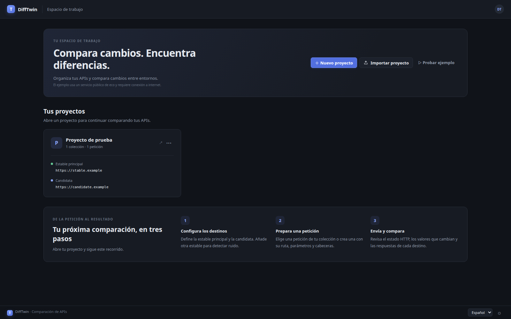
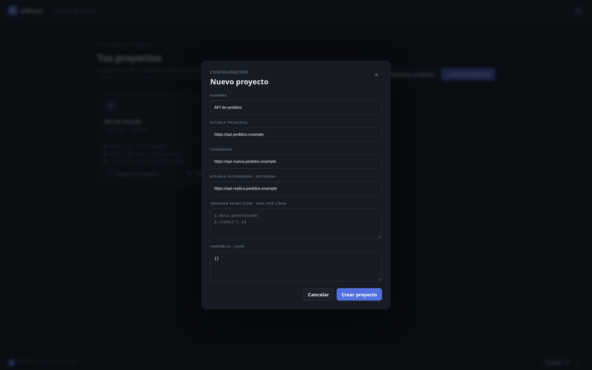
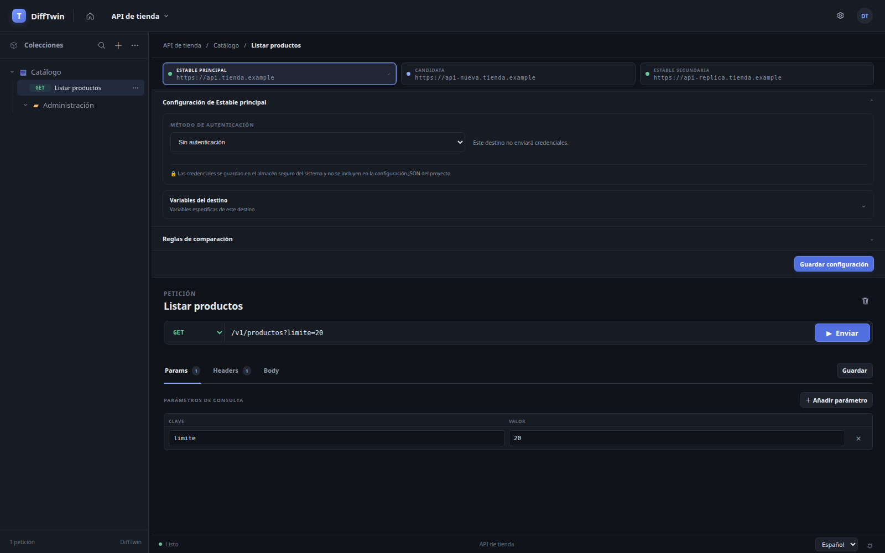
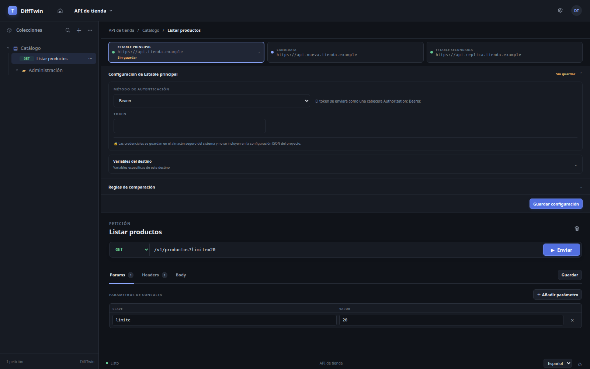
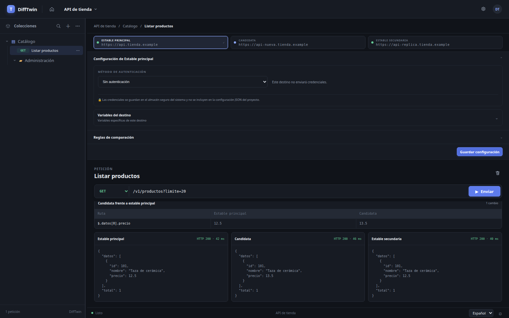

# Manual de usuario de DiffTwin

[English](user-manual.md) | **Español**

DiffTwin es una aplicación de escritorio para comparar respuestas HTTP de API entre entornos. Configura un destino **Estable principal** y uno **Candidata**; el destino opcional **Estable secundaria** ayuda a distinguir los cambios de la candidata de las diferencias que ya existen entre instancias estables.

La interfaz de DiffTwin está disponible en español e inglés. La primera vez que se inicia, usa el idioma del sistema operativo. Puedes cambiar el idioma de la interfaz desde el selector situado en la esquina inferior derecha; la elección se recuerda en este equipo. El botón con el sol o la luna permite alternar entre los temas claro y oscuro; también se recuerda el tema elegido.

Para cambiar el idioma, selecciona **Español** o **English** en el menú de idioma de la esquina inferior derecha. Para cambiar el tema, pulsa el botón del sol o de la luna que está a su lado. El botón indica el tema al que puedes cambiar.

Las capturas de esta guía usan direcciones reservadas `.example` y respuestas ilustrativas. Se han obtenido de la aplicación con un backend de pruebas local; no muestran respuestas de API reales ni credenciales. Los nombres de los controles pueden variar ligeramente según la versión de la aplicación o el idioma seleccionado.

## Contenido

- [Instalar y abrir DiffTwin](#1-instalar-y-abrir-difftwin)
- [Crear un proyecto](#2-crear-un-proyecto)
- [Organizar peticiones](#3-organizar-peticiones)
- [Configurar la autenticación](#4-configurar-la-autenticaci%C3%B3n)
- [Comparar respuestas](#5-comparar-respuestas)
- [Ejecutar una colección](#6-ejecutar-una-colecci%C3%B3n)
- [Importar una colección de Postman](#7-importar-una-colecci%C3%B3n-de-postman)
- [Importar, exportar o eliminar un proyecto](#8-importar-exportar-o-eliminar-un-proyecto)
- [Probar el ejemplo](#9-probar-el-ejemplo)
- [Solución de problemas](#10-soluci%C3%B3n-de-problemas)
- [Datos y privacidad del proyecto](#11-datos-y-privacidad-del-proyecto)

## 1. Instalar y abrir DiffTwin

1. Abre la [página de versiones de DiffTwin](https://github.com/0xdaedal/DiffTwin/releases/latest).
2. Descarga el archivo correspondiente a tu sistema operativo:
   - **Windows:** `difftwin-windows-amd64.zip`
   - **Linux:** `difftwin-linux-amd64.tar.gz`
   - **macOS:** `difftwin-macos-universal.zip`
3. Descomprime el archivo e inicia la aplicación que contiene.

Estos archivos no son instaladores y actualmente no están firmados ni notarizados. Es posible que el sistema operativo muestre un aviso de seguridad la primera vez que abras la aplicación.

## 2. Crear un proyecto

Un proyecto contiene los entornos de la API, la configuración de autenticación, las opciones de comparación, las colecciones y las peticiones de una API o tarea de pruebas.



*Desde el panel puedes crear, abrir, importar, exportar y eliminar proyectos.*

1. En el panel, selecciona **Nuevo proyecto**.
2. Escribe el nombre del proyecto.
3. Introduce la URL base del entorno **Estable principal** y del entorno **Candidata**. Por ejemplo:
   - `https://api.example.com`
   - `https://api-staging.example.com`
4. Si quieres, añade una URL para **Estable secundaria**. Este tercer entorno ayuda a distinguir los cambios de la candidata de las diferencias que ya existen entre instancias estables.
5. Opcionalmente, configura las [rutas JSON que se deben ignorar](#ignorar-diferencias-json-conocidas) y las [variables compartidas](#usar-variables).
6. Selecciona **Crear proyecto**.



*Introduce aquí las URL base; añade la ruta del endpoint en cada petición. La URL de estable secundaria es opcional.*

La ruta de cada petición se añade a la URL base del proyecto. Mantén los nombres de host específicos de cada entorno en las URL del proyecto y usa la misma ruta de petición para compararlos.

Para editar los datos del proyecto más adelante, selecciona **Configuración del proyecto** en la barra superior.

## 3. Organizar peticiones

Los proyectos organizan las peticiones en colecciones y carpetas.

1. Selecciona **Nueva colección** en la barra lateral del espacio de trabajo.
2. Abre el menú **···** de una colección para añadir una petición o carpeta, cambiarle el nombre, ejecutar la colección o eliminarla.
3. Para cambiar el nombre de una colección o carpeta, elige **Renombrar** en su menú de opciones. Edita el nombre en la lista y pulsa **Enter** para guardarlo. Pulsa **Escape** para cancelar. Al hacer clic fuera del campo también se guarda el cambio.
4. Para cambiar el nombre de un proyecto, abre **Configuración del proyecto** desde el botón de engranaje de la barra superior, modifica el nombre y guarda los cambios.
5. Selecciona una petición para editarla. También puedes arrastrar peticiones o carpetas a otra carpeta o colección para moverlas dentro del proyecto.
6. Selecciona **Guardar** en el editor de peticiones para conservar los cambios.



*El árbol de colecciones permanece a la izquierda mientras la configuración de destinos y el editor de peticiones ocupan el panel principal.*

### Configurar una petición

- Elige un método HTTP: `GET`, `POST`, `PUT`, `PATCH`, `DELETE`, `HEAD` u `OPTIONS`.
- Escribe la ruta en el campo de URL, por ejemplo, `/v1/usuarios`.
- En **Params**, añade parámetros de consulta o edítalos directamente en la URL.
- En **Headers**, introduce un objeto JSON, por ejemplo:

  ```json
  {
    "Accept": "application/json"
  }
  ```

- En **Body**, introduce el cuerpo de la petición si es necesario.
- Pulsa **Guardar** antes de salir si quieres conservar la petición.
- Pulsa **Enviar** para ejecutar la petición en los entornos configurados.

DiffTwin ejecuta en paralelo las peticiones contra los destinos configurados. Si una petición contiene variables, estas se sustituyen en la ruta, los parámetros de consulta, las cabeceras y el cuerpo.

## 4. Configurar la autenticación

La autenticación se configura por separado para cada destino en **Configuración de destinos**, dentro del espacio de trabajo. Selecciona la pestaña del destino, elige un método de autenticación, introduce los datos y pulsa **Guardar configuración**.

Métodos disponibles:

- **Sin autenticación**
- Token **Bearer**
- Usuario y contraseña **Basic**
- **API key** en una cabecera o un parámetro de consulta

Las credenciales se guardan en el almacén seguro del sistema operativo, no en el JSON del proyecto. No se incluyen en los archivos exportados. Si importas un proyecto en otro equipo, tendrás que volver a configurar sus credenciales.



*Elige un método de autenticación para el destino seleccionado. Esta captura no contiene ningún token ni otro secreto.*

Si DiffTwin indica que faltan credenciales, vuelve a introducirlas para el destino seleccionado y guarda la configuración. El almacén seguro del sistema operativo debe estar disponible para guardar o usar peticiones autenticadas.

## 5. Comparar respuestas

Después de pulsar **Enviar**, DiffTwin muestra un resultado, los detalles de las respuestas y las diferencias entre los destinos Estable principal y Candidata.



*Las diferencias se muestran por ruta JSON, con los valores de Estable principal y Candidata uno junto al otro. Desplázate por el editor de peticiones para consultar la comparación y los cuerpos de las respuestas.*

La comparación incluye el estado HTTP, las cabeceras y los cuerpos de las respuestas. Se normaliza el orden de las claves de los objetos JSON y se excluyen algunas cabeceras de transporte o variables. La latencia se muestra como referencia, pero no afecta al resultado.

Si configuras un destino Estable secundaria, DiffTwin también compara las dos respuestas estables. Las diferencias entre ellas pueden indicar ruido existente en los entornos y no un cambio exclusivo de la candidata.

En las respuestas JSON, las diferencias se muestran como rutas y valores. El panel presenta hasta 100 diferencias. Los cuerpos de respuesta que se muestran están limitados a 2 MiB.

### Ignorar diferencias JSON conocidas

Al crear o editar un proyecto, introduce las rutas JSON que quieras ignorar en **IGNORAR RUTAS JSON · UNA POR LÍNEA**. Por ejemplo:

```text
$.meta.generatedAt
$.items[*].id
$["field.with.dots"]
```

Se admiten rutas exactas y comodines `*`. Las rutas ignoradas se excluyen de la comparación del cuerpo JSON.

### Usar variables

Las variables compartidas se introducen como objeto JSON en la configuración del proyecto:

```json
{
  "userId": "123"
}
```

Usa una variable entre llaves dobles en la ruta, los parámetros de consulta, las cabeceras o el cuerpo de una petición; por ejemplo, `/v1/usuarios/{{userId}}`. Las variables específicas de un destino pueden reemplazar las compartidas; las demás conservan el valor compartido.

**No guardes secretos en las variables del proyecto.** Los datos del proyecto, incluidas las variables, se almacenan en un archivo JSON sin cifrar. Usa la configuración de autenticación para las credenciales.

## 6. Ejecutar una colección

Abre el menú de opciones de una colección y selecciona **Ejecutar colección**. DiffTwin ejecuta las peticiones secuencialmente en el orden mostrado, indica el progreso y el resultado de cada petición, y continúa aunque una de ellas falle. Selecciona un resultado completado para abrir su comparación.

También puedes ejecutar una petición individual en cualquier momento con **Enviar**.

## 7. Importar una colección de Postman

1. Abre un proyecto.
2. Abre el menú de opciones situado en la parte superior de la barra lateral de colecciones.
3. Selecciona **Importar colección de Postman** y elige un archivo JSON de Postman v2.0 o v2.1.

DiffTwin conserva las carpetas, los métodos, las rutas y los parámetros de consulta, las cabeceras, los cuerpos de texto sin formato y las variables de colección compatibles. No importa las URL de host de Postman: las peticiones importadas usan los destinos configurados en el proyecto de DiffTwin. La aplicación informa de los elementos no compatibles, como los scripts, la autenticación de colección y algunos formatos de cuerpo.

## 8. Importar, exportar o eliminar un proyecto

### Exportar

En el panel, selecciona **Exportar proyecto** en la tarjeta del proyecto. Elige el nombre y la ubicación del archivo en el cuadro de diálogo para guardar. DiffTwin confirma dónde se guardó el archivo JSON.

La exportación contiene la configuración del proyecto y las peticiones, pero **no incluye las credenciales**. Trata los archivos exportados como datos de proyecto sin cifrar.

### Importar

En el panel, selecciona **Importar proyecto** y elige un archivo JSON de proyecto de DiffTwin. Si ya existe un proyecto con el mismo identificador, selecciona una de las opciones disponibles:

- **Reemplazar proyecto**: reemplaza sus colecciones y peticiones con los datos importados. Se eliminan sus credenciales guardadas; tendrás que configurar de nuevo la autenticación.
- **Importar como copia**: crea una copia independiente del proyecto.
- **Cancelar**: deja el proyecto existente sin cambios.

### Eliminar

Selecciona **Eliminar** en la tarjeta del proyecto y confirma la eliminación. Se eliminarán permanentemente el proyecto, sus colecciones, sus peticiones y sus credenciales guardadas.

## 9. Probar el ejemplo

Selecciona **Probar ejemplo** en el panel para crear o abrir el proyecto de demostración de comparación de API integrado. Envía peticiones a HTTPBin, un servicio público de Internet, para mostrar una diferencia en la URL de la respuesta.

El ejemplo necesita conexión a Internet. No envíes datos privados, credenciales ni otra información sensible al servicio público.

## 10. Solución de problemas

| Problema | Qué puedes probar |
| --- | --- |
| No se puede conectar una petición | Comprueba la URL base, la ruta de la petición, la conexión de red y que la API esté disponible desde este equipo. |
| Una petición autenticada indica que faltan credenciales | Abre **Configuración de destinos**, selecciona el destino afectado, vuelve a introducir las credenciales y guarda la configuración. |
| No se pueden guardar las credenciales | Comprueba que el almacén seguro del sistema operativo esté disponible. En Windows, actualiza DiffTwin a una versión reciente si falla el guardado de un conjunto grande de credenciales. |
| No se pueden guardar o utilizar las cabeceras | Comprueba que el campo **Headers** contenga JSON válido, con nombres de propiedades entre comillas y valores de texto. |
| La candidata muestra diferencias, pero no está claro el motivo | Configura un destino Estable secundaria. Las diferencias entre las dos respuestas estables pueden indicar ruido existente. |
| Las peticiones de Postman apuntan al servidor incorrecto | Configura las URL base Estable principal y Candidata correctas en el proyecto de DiffTwin; las URL de host de Postman no se importan. |
| El ejemplo no se ejecuta | Comprueba la conexión a Internet. El ejemplo usa un servicio público. |

## 11. Datos y privacidad del proyecto

La configuración y las peticiones del proyecto se guardan como JSON en el directorio de configuración del usuario. Estos datos no están cifrados y pueden incluir URL, variables, cabeceras y cuerpos de peticiones. No guardes secretos en esos campos ni compartas archivos de proyecto sin revisar su contenido.

Las credenciales de autenticación se guardan por separado en el almacén seguro del sistema operativo. No se incluyen en las exportaciones del proyecto. Las claves API enviadas como parámetros de consulta pueden quedar registradas en servidores, proxies u otros componentes de la infraestructura; si la API lo permite, envíalas en una cabecera.
