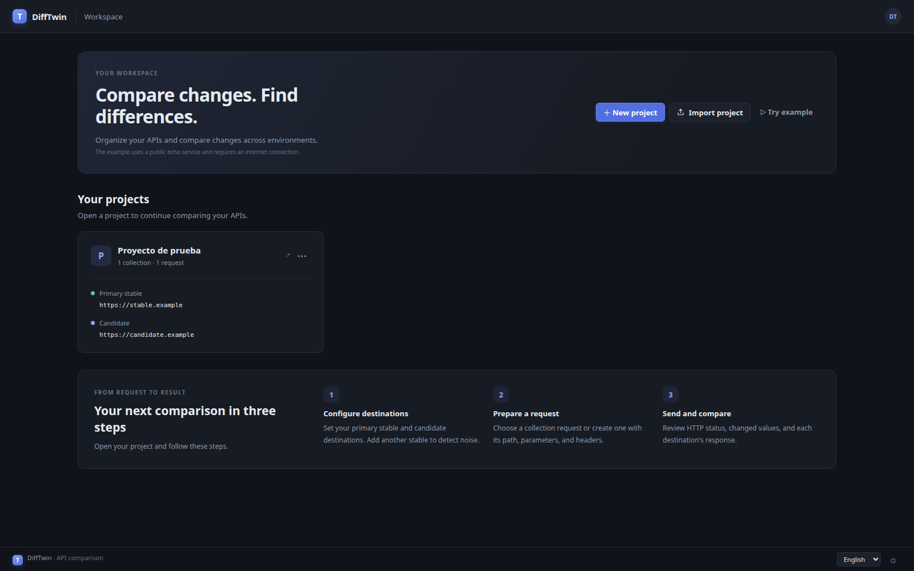
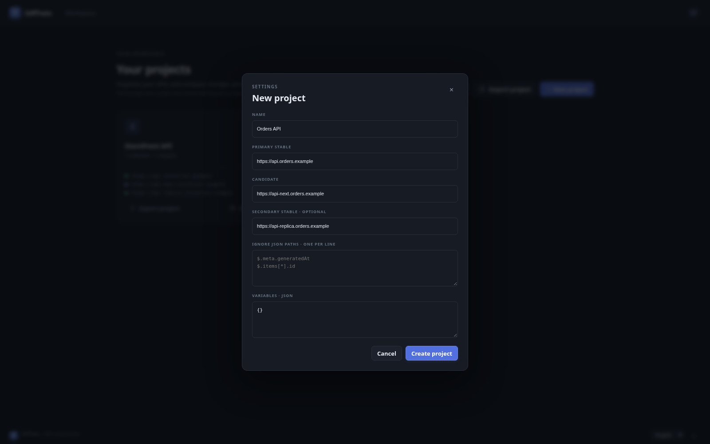
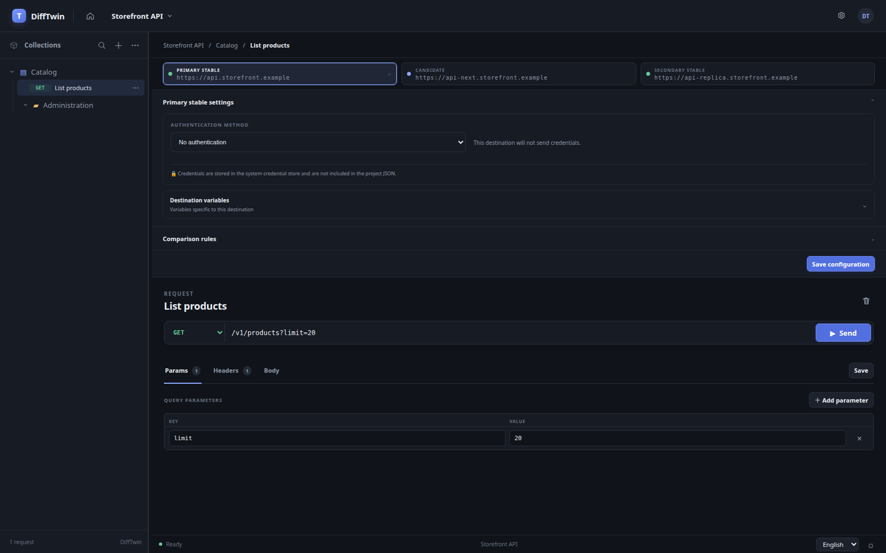
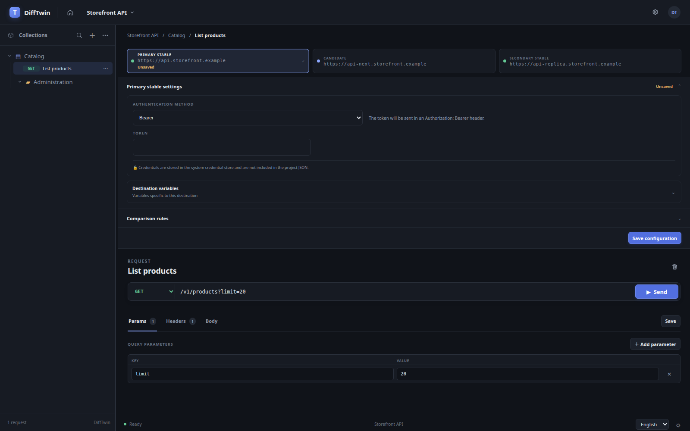
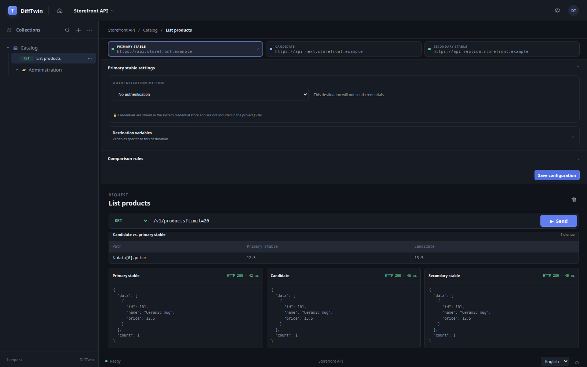

# DiffTwin User Manual

**English** | [Español](user-manual.es.md)

DiffTwin is a desktop application for comparing HTTP API responses across environments. Configure a **primary stable** destination and a **candidate** destination; an optional **secondary stable** destination helps distinguish candidate changes from differences that already exist between stable instances.

DiffTwin's interface is available in English and Spanish. On first launch, it follows the operating system language. Use the language selector in the bottom-right corner to change the interface language; your choice is remembered on this computer. Use the adjacent sun or moon button to switch between light and dark themes; the selected theme is also remembered.

To change the language, choose **English** or **Español** from the language menu in the bottom-right corner. To change the theme, select the sun or moon button beside it. The button indicates the theme you can switch to.

The screenshots in this guide use reserved `.example` URLs and illustrative response data. They were captured from the application with a local test backend; they do not show live API responses or real credentials. Labels may vary slightly with the application version or selected language.

## Contents

- [Install and open DiffTwin](#1-install-and-open-difftwin)
- [Create a project](#2-create-a-project)
- [Organize requests](#3-organize-requests)
- [Configure authentication](#4-configure-authentication)
- [Compare responses](#5-compare-responses)
- [Run a collection](#6-run-a-collection)
- [Import a Postman collection](#7-import-a-postman-collection)
- [Import, export, or delete a project](#8-import-export-or-delete-a-project)
- [Try the example](#9-try-the-example)
- [Troubleshooting](#10-troubleshooting)
- [Project data and privacy](#11-project-data-and-privacy)

## 1. Install and open DiffTwin

1. Open the [DiffTwin releases page](https://github.com/0xdaedal/DiffTwin/releases/latest).
2. Download the archive for your operating system:
   - **Windows:** `difftwin-windows-amd64.zip`
   - **Linux:** `difftwin-linux-amd64.tar.gz`
   - **macOS:** `difftwin-macos-universal.zip`
3. Extract the archive and launch the application inside.

These downloads are not installers and are not currently code-signed or notarized. Your operating system may show a security warning when you first open the app.

## 2. Create a project

A project holds the API environments, authentication settings, comparison options, collections, and requests for one API or testing effort.



*The dashboard is where you create, open, import, export, and delete projects.*

Open a project by selecting its name. With a single project, the dashboard also shows a three-step guide to configuring destinations, preparing requests, and comparing responses.

1. On the dashboard, select **New project**.
2. Enter a project name.
3. Enter the base URL for the **Stable primary** environment and the **Candidate** environment. For example:
   - `https://api.example.com`
   - `https://api-staging.example.com`
4. Optionally enter a **Stable secondary** URL. This third environment is used to help distinguish candidate changes from differences between stable instances.
5. Optionally configure [JSON paths to ignore](#ignore-known-json-differences) and shared [variables](#use-variables).
6. Select **Create project**.



*Use base URLs here; add the endpoint path to each request. The secondary stable URL is optional.*

The request path is appended to each project's base URL. Keep environment-specific hostnames in the project URLs and use the same request path to compare environments.

To edit project details later, select **Project settings** in the top bar.

## 3. Organize requests

Projects organize requests into collections and folders.

1. Select **New collection** in the workspace sidebar.
2. Open a collection's **···** options menu to add a request or folder, rename it, run the collection, or delete it.
3. To rename a collection or folder, choose **Rename** from its options menu. Edit the name in the list, then press **Enter** to save. Press **Escape** to cancel. Clicking outside the name field also saves the change.
4. To rename a project, open **Project settings** from the gear control in the top bar, change its name, and save the changes.
5. Select a request to edit it. You can also drag requests or folders onto another folder or collection to move them within the project.
6. Select **Save** in the request editor to keep your changes.



*The collection tree stays on the left while the destination settings and request editor occupy the main panel.*

### Configure a request

- Choose an HTTP method: `GET`, `POST`, `PUT`, `PATCH`, `DELETE`, `HEAD`, or `OPTIONS`.
- Enter the path in the URL field, such as `/v1/users`.
- In **Params**, add query parameters or edit them in the URL.
- In **Headers**, enter a JSON object, for example:

  ```json
  {
    "Accept": "application/json"
  }
  ```

- In **Body**, enter the request body, if needed.
- Select **Save** before leaving if you want to keep the request.
- Select **Send** to run the request against the configured environments.

DiffTwin runs the configured destinations in parallel. If a request contains variables, they are substituted in its path, query parameters, headers, and body.

## 4. Configure authentication

Authentication is configured separately for each destination in **Configuration of destinations** in the workspace. Select the destination tab, choose an authentication method, enter its details, and select **Save options**.

Supported methods are:

- **No authentication**
- **Bearer** token
- **Basic** username and password
- **API key** in a header or query parameter

Secrets are stored in the operating system's secure credential store, not in the project JSON. They are not included in exported project files. When you import a project on another computer, configure its credentials again.



*Choose an authentication method for the selected destination. This example deliberately contains no token or other secret.*

If DiffTwin reports that credentials are missing, re-enter them for the selected destination and save the options. The operating system's credential store must be available to save or use authenticated requests.

## 5. Compare responses

After selecting **Send**, DiffTwin displays a verdict, response details, and differences between the stable primary and candidate destinations.



*Differences are shown by JSON path, with the primary stable and candidate values side by side. Scroll the request editor to inspect the comparison and response bodies.*

The comparison includes HTTP status, response headers, and response bodies. JSON object key order is normalized. Some transport-specific or volatile headers are excluded. Latency is shown for context but does not affect the verdict.

When a stable secondary destination is configured, DiffTwin also compares the two stable responses. A difference between them may indicate existing environment noise rather than a candidate-only change.

For JSON responses, differences are shown as paths and values. The interface displays up to 100 differences in a panel. Response bodies are limited to 2 MiB for display.

### Ignore known JSON differences

When creating or editing a project, enter JSON paths in **Ignore JSON paths**, one per line. For example:

```text
$.meta.generatedAt
$.items[*].id
$["field.with.dots"]
```

Exact paths and `*` wildcards are supported. Ignored paths are excluded from the JSON body comparison.

### Use variables

Shared variables are entered as a JSON object in the project settings:

```json
{
  "userId": "123"
}
```

Use a variable with double braces in a request path, query parameter, header, or body, for example `/v1/users/{{userId}}`. Destination-specific variables can override shared values; unspecified variables continue to use their shared values.

**Do not put secrets in project variables.** Project data, including variables, is stored in a JSON file and is not encrypted. Use the authentication settings for credentials.

## 6. Run a collection

Open a collection's options menu and select **Run collection**. DiffTwin executes its requests sequentially in the displayed order, shows progress and each request's outcome, and continues if an individual request fails. Select a completed result to open its comparison.

You can still run an individual request at any time with **Send**.

## 7. Import a Postman collection

1. Open a project.
2. Open the options menu at the top of the collections sidebar.
3. Select **Import Postman collection** and choose a Postman v2.0 or v2.1 JSON file.

DiffTwin preserves supported folders, methods, paths and query parameters, headers, raw bodies, and collection variables. Postman host URLs are not used; the imported requests use the destinations configured in the DiffTwin project. DiffTwin reports unsupported items, such as scripts, collection authentication, and unsupported body formats.

## 8. Import, export, or delete a project

### Export

On the dashboard, open the **···** options menu on a project card and select **Export project**. Choose the file name and location in the save dialog. DiffTwin confirms where the JSON file was saved.

The export contains project configuration and requests, but **does not contain credentials**. Treat exported files as unencrypted project data.

### Import

On the dashboard, select **Import project** and choose a DiffTwin project JSON file. If a project with the same identifier already exists, choose one of the displayed options:

- **Replace project**: replaces its collections and requests with the imported data. Its saved credentials are removed; configure authentication again.
- **Import as copy**: creates a separate project copy.
- **Cancel**: leaves the existing project unchanged.

### Delete

Open the **···** options menu on a project card, select **Delete**, and confirm the deletion. This permanently removes the project, its collections and requests, and its saved credentials.

## 9. Try the example

Select **Try example** on the dashboard to create or open the built-in API comparison demo. It sends requests to HTTPBin, a public internet service, to demonstrate a difference in the response URL.

The example requires an internet connection. Do not send private data, credentials, or other sensitive information to the public service.

## 10. Troubleshooting

| Issue | What to try |
| --- | --- |
| A request cannot connect | Check the base URL, request path, network connection, and whether the API is reachable from this computer. |
| An authenticated request reports missing credentials | Open **Configuration of destinations**, select the affected destination, re-enter its credentials, and save the options. |
| Credentials cannot be saved | Check that the operating system's secure credential store is available. On Windows, update to a recent DiffTwin release if saving a large set of credentials fails. |
| Headers cannot be saved or used | Make sure the **Headers** field contains valid JSON with quoted property names and string values. |
| The candidate differs, but the cause is unclear | Configure a stable secondary destination. Differences between the two stable responses may indicate existing noise. |
| Imported Postman requests target the wrong server | Set the correct stable and candidate base URLs in the DiffTwin project; Postman hosts are intentionally not imported. |
| The example does not run | Check your internet connection. The example uses a public service. |

## 11. Project data and privacy

Project configuration and requests are stored as JSON in the user's configuration directory. This data is not encrypted and may include URLs, variables, request headers, and bodies. Do not store secrets in those fields or share project files without checking their contents.

Authentication secrets are stored separately in the operating system's secure credential store. They are not included in project exports. API keys sent as query parameters may be recorded by servers, proxies, or other infrastructure; use a header when the API supports it.
